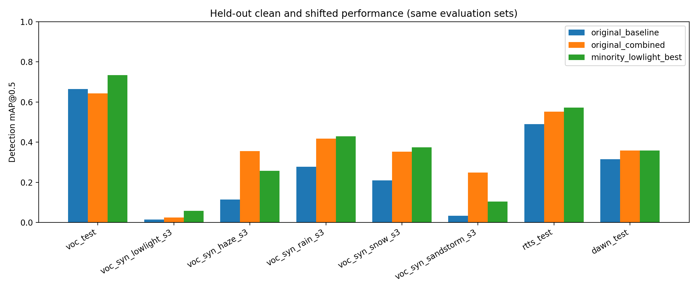

# Classification in Class-Imbalanced Extremely Shifted Images

**IE643 — Deep Learning: Theory and Practice | IIT Bombay**  
**Team:** Latent Navigators (single member)  
**Author:** Ananna Biswas (25M1727)  
**Project:** Classification in Class-Imbalanced Extremely Shifted Images

I investigate the effect of **class imbalance** and **extreme image degradation** on two computer-vision tasks:

- **Multi-label image classification:** pretrained **ResNet-50**, adapted to 10 selected PASCAL VOC classes.
- **Object detection:** pretrained **YOLOv8n**, adapted to the same 10 classes and evaluated using mAP at IoU 0.5.

I study five synthetic shifts (**haze, low light, rain, snow, sandstorm**) at three severity levels, along with available real-world shifted benchmarks. The later novelty experiment focuses on improving YOLO detection while retaining clean-image accuracy.



## Main contribution

The novelty is a **clean-anchored, minority-aware, low-light-focused YOLOv8n fine-tuning strategy**, not a newly invented YOLO architecture. I compared three equal-budget training arms:

1. **Uniform views:** all 1,176 clean images plus 1,176 uniformly sampled degraded views.
2. **Minority sampling:** retain all clean images, but preferentially sample minority-positive images for degraded views.
3. **Minority + low light (proposed):** retain clean anchors and minority sampling while preferentially adding low-light degradation for rare classes.

Each arm had **2,352 training views**. The novelty notebook records eight fine-tuning epochs, 640-pixel image size, batch size 16, an initial learning rate of 0.0002, and freezing of the first ten YOLO modules.

## Key results (held-out detection mAP@0.5)

| Evaluation | Original baseline | Earlier combined | Proposed |
|---|---:|---:|---:|
| VOC clean | 0.664 | 0.643 | **0.734** |
| Synthetic low light, severity 3 | 0.015 | 0.026 | **0.058** |
| Real RTTS haze | 0.490 | 0.552 | **0.573** |
| Synthetic haze, severity 3 | 0.114 | **0.355** | 0.257 |
| Synthetic sandstorm, severity 3 | 0.034 | **0.249** | 0.105 |

In addition, clean VOC *minority-class recall* increased from **0.495** (original baseline) to **0.607** (proposed). The method did **not** outperform the earlier combined detector on every corruption, and severity-3 low-light detection remained poor in absolute terms.

**Evidence:** `results/novelty/heldout_detection_results.csv` (per-class AP/recall and all recorded evaluation conditions), `results/novelty/tune_selection_scores.csv`, and `results/novelty/training_manifest_summary.csv`. Values above are rounded from those files. Classification mAP and detection mAP measure different tasks and should not be directly equated.

## Repository structure

```text
notebooks/
  01_classification_and_detection.ipynb   # original ResNet-50 + YOLOv8n workflow
  02_novelty_clean_anchored_yolov8n.ipynb # later 3-arm novelty study
results/
  classification/                        # earlier classifier summary CSVs
  earlier_detection/                     # earlier detector CSVs
  novelty/                               # held-out, tuning, selection, configs, diagnostics
figures/
  project/novelty_comparison.png
  qualitative/                           # actual exported detection examples
poster/
  IE643_Poster_Final_A1.pdf              # printed Version 11 (A1 portrait)
  latex/                                  # editable source and dependencies
reports/
  Intensive_Assessment_Report.pdf
  Novelty_Assessment_2pages.pdf
scripts/
  show_key_results.py                    # lightweight results-reader utility
```

## How to run the research notebooks

1. Use **Google Colab with a GPU**, or a compatible Python environment with GPU-enabled PyTorch. Install dependencies from `requirements.txt` (the notebook setup cells may install additional packages). Package versions are **not pinned to the historic runtime**, so rerunning may require adapting code for newer libraries.
2. Open `notebooks/01_classification_and_detection.ipynb` for PASCAL VOC data preparation, ResNet-50 experiments and earlier YOLO baselines. Review its configuration cell, Colab Drive mounting, data paths and the `QUICK_RUN` flag **before** running all cells.
3. Open `notebooks/02_novelty_clean_anchored_yolov8n.ipynb` for the three matched YOLO fine-tuning arms. This notebook **requires the original trained YOLO baseline checkpoint**, and optionally the earlier combined checkpoint. Paths must be adjusted to your Drive before running.
4. The notebooks expect **PASCAL VOC 2012** (some code can download it); RTTS, DAWN and ExDark sources require their corresponding image data and annotations. These full image datasets are **not redistributed here**.
5. Results saved under `results/` are the recorded experiment outputs, not newly computed by this repository packaging. You can inspect key held-out scores without GPU using `python scripts/show_key_results.py`.

**Important checkpoint limitation:** The CSV records identify the selected checkpoint as `minority_lowlight_best` at a Colab Drive path. **That exact `.pt` file is not in this upload package.** I have not substituted the available generic `best.pt`, because its identity cannot be established as the selected novelty model. Obtain the correct weights from the original Colab/Drive run if you want a runnable public detection demo. See `CHECKPOINTS_AND_DATA.md`.

## Poster and video

- **Final A1 poster:** [`poster/IE643_Poster_Final_A1.pdf`](poster/IE643_Poster_Final_A1.pdf)
- **Demo video folder:** [Google Drive link](https://drive.google.com/drive/folders/1WqmOQDdKV1TnngI-oDce9uJfPOYvQpE4?usp=sharing) (a shared folder; the recording may be added or updated separately)

## Research notes and limitations

- The selected model was chosen using separate VOC tuning data with a clean-performance safeguard, then reported on held-out tests.
- The three new arms hold overall image count and major training settings constant. Since all three use clean anchors and freezing, their separate contributions are **not isolated** by this ablation.
- Synthetic corruption does not fully represent all real environmental conditions.
- Rare-class image reuse may cause overfitting; the small qualitative subset is diagnostic, not a substitute for full-test recall.
- Trained checkpoints and full source datasets are not bundled. Original paths in the notebooks and recorded CSVs refer to the author's Colab environment.

## References / tools

- PASCAL Visual Object Classes (VOC) benchmark: https://host.robots.ox.ac.uk/pascal/VOC/
- He et al., *Deep Residual Learning for Image Recognition* (ResNet), CVPR 2016.
- Cui et al., *Class-Balanced Loss Based on Effective Number of Samples*, CVPR 2019.
- Ultralytics YOLOv8: https://github.com/ultralytics/ultralytics

**License:** No open-source license has been selected for this student project. Do not assume the files or third-party datasets/logos are licensed for unrestricted reuse.
